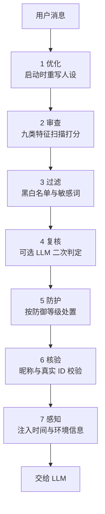

<p align="center">
  
</p>

<h1 align="center">aPromptGuardian</h1>

<p align="center">AstrBot 插件：在消息交给模型之前，先过一遍检查和处理。</p>

<p align="center">报错和想法可以加 Q 群或私聊 181874337，GitHub 上看得不勤。</p>

<p align="center">
  
  
</p>

---

## 做什么的

消息进到 LLM 之前其实还有一堆事：注入指令要拦、冒充身份要辨、人设被改写要挡、时间和环境信息要补上。这些原本得装好几个插件分别配，容易漏。

这个插件把它们串成一条按顺序走的流水线：优化 → 审查 → 过滤 → 复核 → 防护 → 核验 → 感知，七步依次执行。装上以后自动接管，不用再单独指定审查模型；提示词优化和 LLM 复核直接复用 AstrBot 正在用的那个模型，没配模型也不影响防御拦截，只是这两层会跳过。

## 流水线



| 步骤 | 阶段 | 做什么 | 何时跑 |
| --- | --- | --- | --- |
| 1 | 优化 | 把 AstrBot 当前人设重写成结构化版本 | 插件启动时 |
| 2 | 审查 | 越狱、关键词、正则、人设冲突、仇恨、骚扰、外链、编码、一致性，九类启发式打分 | 每次请求 |
| 3 | 过滤 | 静态黑白名单、动态封禁、输入输出敏感词 | 每次请求 |
| 4 | 复核 | 分数在临界区的请求交给 LLM 再看一遍，减少误判 | 可选 |
| 5 | 防护 | 按防御等级处置：观察、标注放行、只去掉危险内容、拦截 | 每次请求 |
| 6 | 核验 | 昵称和真实 ID 对不上就拦，防冒充 | 每次请求 |
| 7 | 感知 | 日期、星期、时间段、节气、农历、节假日、平台信息 | 每次请求 |

## 检测什么

九类维度各有开关，可以单独关掉：

| 类别 | 常见手法 | 等级 |
| --- | --- | --- |
| 越狱诱导 | 忽略之前的指令、进入开发者模式、DAN | 严重 |
| 注入关键词 | 覆盖系统提示词、无条件服从、只听我的 | 严重 |
| 注入正则 | 伪造系统消息、`<system>` 标签、JSON role 注入 | 严重 |
| 人设冲突 | 你现在不是助手了、改写角色设定 | 严重 |
| 仇恨内容 | 针对特定群体的负面刻板印象请求 | 严重 |
| 骚扰辱骂 | 性骚扰、辱骂、霸凌、胁迫 | 高危 |
| 恶意外链 | pastebin、rentry 这类托管站加 curl/fetch 拉取指令 | 高危 |
| 编码混淆 | Base64、百分号、Unicode、hex 里夹带注入特征 | 高危 |
| 人设一致性 | 对当前人设做兼容度打分，越界请求加分 | 中危 |

## 防御怎么调

| 项 | 可选值 | 说明 |
| --- | --- | --- |
| 防御力度 | 低 / 中 / 高 | 对应 11 / 7 / 4 三条风险阈值 |
| 防御等级 | 观察 / 标注放行 / 只去危险内容 / 拦截 | 越往后越严 |
| 防御后保护 | 无 / 重读设定 / 强制刷新 | 强制刷新会清空上下文换新会话，用来隔离污染 |
| LLM 复核 | 一直 / 判危险时 / 从不 | 默认只在临界分时介入 |

## 提示词优化

打开以后，插件启动或重载时用 AstrBot 当前的模型把人设重写一遍，按类型分别处理：

- 智能体：拆成角色目标、工具清单、调用规范、决策规则、错误处理、终止条件
- 专业型：强化领域边界、术语一致性、准确性和依据要求
- 角色扮演：输出结构化的 JSON 角色卡

优化前会自动备份原始提示词，用 `/回滚人设` 可以还原。

## 安装

```bash
# 插件市场搜 aPromptGuardian 直接装
# 或者手动克隆
git clone https://github.com/Seeeaa/astrbot_plugin_aPromptGuardian

# 没装 git 的话，去 Releases 下 Source code (zip)，解压后整个文件夹放进 data/plugins
```

重启 AstrBot，插件自动加载。管理面板在 AstrBot WebUI 的插件详情页里，点开可视化视图就能用。

依赖会自动装。`chinese-calendar` 和 `lunarcalendar` 缺失时，农历和节假日换成简化版，其他功能不受影响。

## 命令

都需要 AstrBot 管理员权限，`/pg帮助` 随时可查。

| 命令 | 说明 |
| --- | --- |
| `/pg统计` | 拦截统计 |
| `/pg日志` | 最近的拦截记录 |
| `/pg配置` | 当前配置 |
| `/切换力度 低\|中\|高` | 换防御力度 |
| `/切换等级 观察\|标注\|仅去除危险内容\|拦截` | 换防御等级 |
| `/复核 一直\|判危险时\|从不` | 换 LLM 复核方式 |
| `/防骚扰 开\|关` | 仇恨与骚扰检测总开关 |
| `/拉黑 ID [分钟]` `/解封 ID` | 动态封禁，0 表示永久 |
| `/黑名单` `/白名单` | 看名单 |
| `/加白 ID` `/移白 ID` | 维护白名单 |
| `/优化 开\|关` | 提示词优化开关 |
| `/回滚人设` | 恢复备份的初始提示词 |

## 管理面板

用 AstrBot 的插件可视化视图做的，集成在 WebUI 里，不另开端口。

<p align="center">
  
</p>

| 分区 | 内容 |
| --- | --- |
| 优化 | 开关、自动备份、回滚按钮 |
| 防护 | 力度、等级、复核、防御后保护、九类检测开关、黑白名单与敏感词 |
| 身份 | 昵称到真实 ID 的映射表、检查方式、提醒模板 |
| 感知 | 时区和八个环境开关 |
| 封禁 | 拉黑、解封、剩余时长 |
| 日志 | 时间、用户、处置、原因 |

## 配置

在 AstrBot 后台改，或者直接改 `_conf_schema.json`。字段都有中英文备注，五个分区共三十七项，这里只列常用的：

| 字段 | 类型 | 默认 | 说明 |
| --- | --- | --- | --- |
| `enable_optimize` | 布尔 | `false` | 提示词优化 |
| `enable_auto_backup` | 布尔 | `true` | 优化前自动备份 |
| `defense_sensitivity` | 枚举 | `medium` | 防御力度 |
| `defense_action` | 枚举 | `block` | 防御等级 |
| `post_defense_protection` | 枚举 | `reread` | 防御后保护 |
| `llm_review` | 枚举 | `risk` | LLM 复核触发条件 |
| `auto_ban` / `ban_duration` | 布尔 / 数字 | `false` / `60` | 自动拉黑和时长 |
| `id_map_list` | 结构化 | `[]` | 昵称到真实 ID 映射 |
| `check_mode` | 枚举 | `exact` | 身份检查方式 |

## 更新日志

### v1.1.1

- 去掉黄历宜忌感知，精简代码

### v1.1.0

- 新增 `/回滚人设` 和面板上的回滚按钮，配合优化前自动备份
- 防御后保护三档：无、重读设定、强制刷新
- 九类检测拆成独立开关，默认全开
- 破坏性命令正则补齐 rm 各种写法，单条命中就拦
- 修四处漏检：遗忘设定、人设覆盖、服从要求、覆盖系统提示词，编码混淆的权重也调了
- 命令改的配置会落盘，重启不丢

## 依赖

- `chinese-calendar`：法定节假日与调休
- `lunarcalendar`：农历转换

## 许可

MIT，见 [LICENSE](./LICENSE)。
